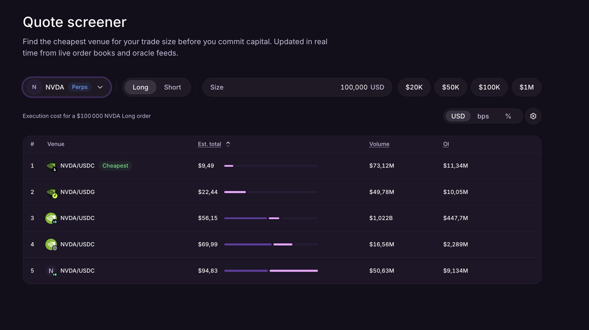
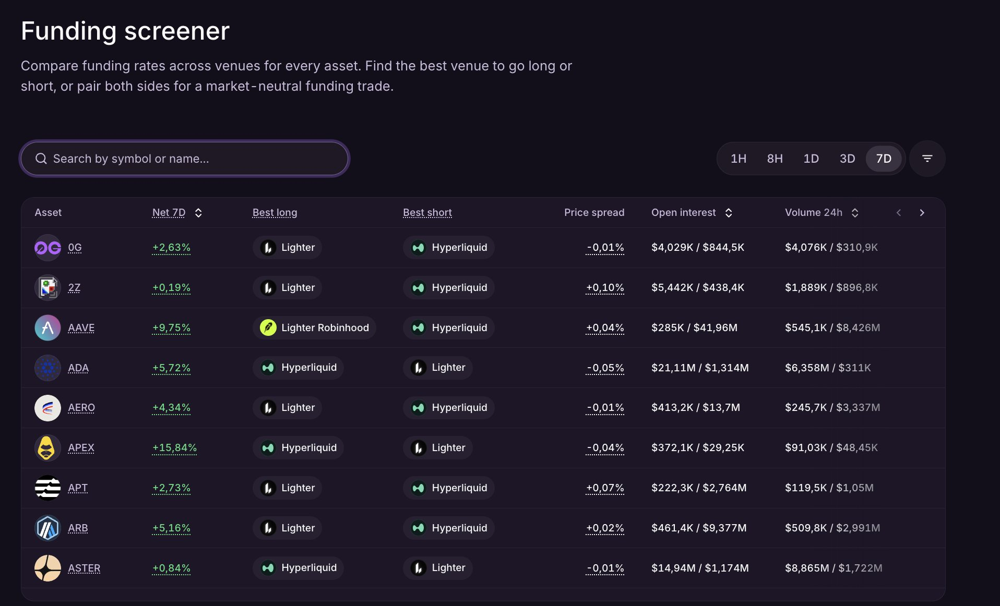
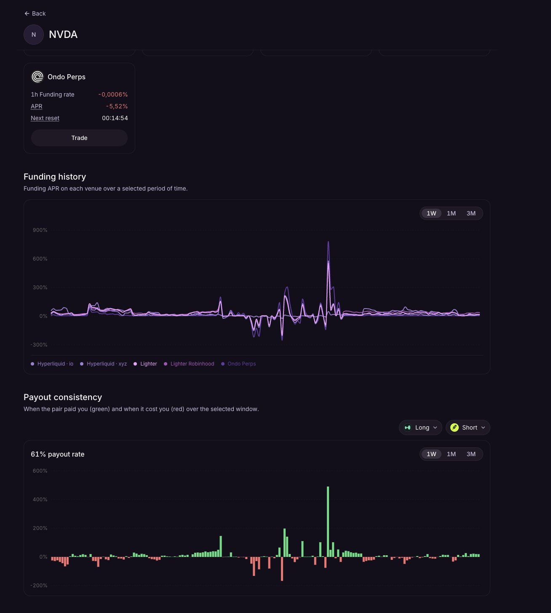

Jumper Perps is a dedicated surface for trading perpetual futures across multiple venues, on desktop and mobile.

Perps liquidity is spread across venues such as Hyperliquid, Lighter and Ondo, and each has its own interface, deposit and withdrawal flow, margin account and conventions. Jumper Perps brings them together in one place: a single trading terminal, a single portfolio, and one consistent way to trade, whichever venue you use.

Because you can compare venues at all times, it's easier to make sure you're trading in the right place, and not opening a position on a market with unfavorable funding or high slippage when a better option exists.

## Supported venues

Jumper Perps currently aggregates the following venues:

- Hyperliquid
- Lighter
- Lighter Robinhood
- Ondo

## Fees

For a complete breakdown of Jumper fees on Perps see [Fees](https://docs.jumper.xyz/jumper-fees#jumper-perps-fees).

## Trading terminal

The trading terminal is the home of Jumper Perps: one workspace per market where you can watch the market, place trades and manage your orders from start to finish without leaving the screen.

The terminal is organized into five areas: Market selector and header, Price chart, Account and activity, Execution panel, Execution details

The following order types are supported:

- Market
- Limit
- TWAP
- Take Profit / Stop Loss (TP/SL)

## Venue comparison

When you place a trade, Jumper compares quotes for the same market across the supported venues.

If another venue would give you a better fill, Jumper suggests switching to it, so you can make an informed choice before you trade.

## Portfolio

The portfolio gives you one view of your positions and balances across every venue you trade on.

Instead of checking each venue's interface separately, you can follow your exposure, open positions and available margin in one place.

## Deposits, withdrawals & margin

You can deposit to and withdraw from each supported venue directly through Jumper, without going to the venue's own interface.

You can also move margin within a venue. Moving margin between different venues is not supported yet.

## Intelligence

#### Quote screener

The **Quote Screener** lets you compare the actual cost of placing a trade on any asset across different venues, factoring in both slippage and trading fees.  No more switching between 3 or 4 different panels to figure out where to trade. You can now compare execution costs across venues in one place and easily identify the best option.

#### Funding screener

The **Funding Screener** helps you identify the most attractive funding rate arbitrage opportunities across venues: go long on one venue, short on another, and capture the funding rate difference.  You can compare projected APRs based on different historical timeframes, ranging from the last 1 hour to the last 7 days, to spot the best opportunities.

For a deeper dive, the detail page gives you a complete view of historical funding rates across different timeframes, regardless of your position size, so you can easily assess how consistent and sustainable those opportunities have been over time.

<Warning>
  Perpetual futures are leveraged products and carry a high level of risk, including the risk of liquidation and losing your full margin. Trades are executed on third-party venues, each with its own terms, margin rules, funding mechanics and eligibility requirements. Review the relevant venue terms before trading.
</Warning>

## Coming soon

- Intelligence
- Transfer Margin
